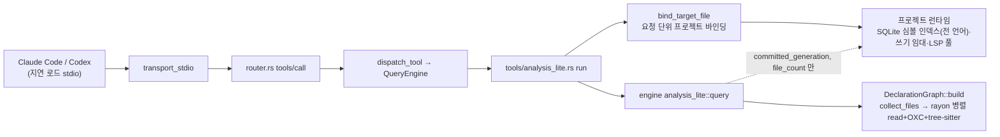
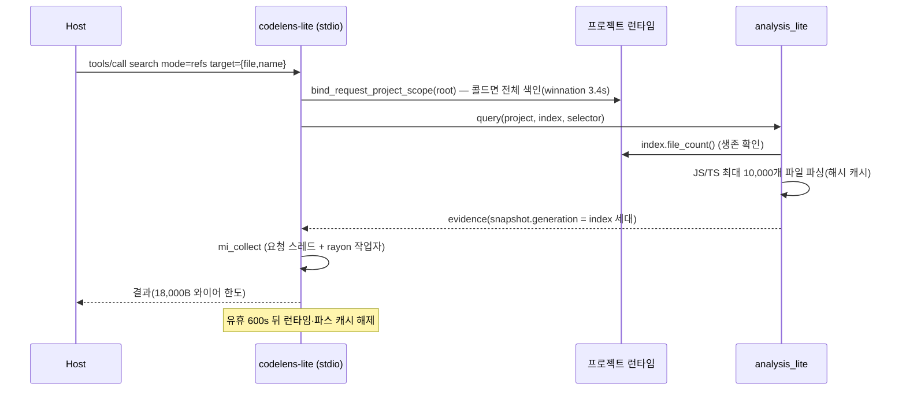

# CodeLens 아키텍처 감사 — 최적화·개선 (델타)

- 요청: 「코드렌즈 최적화개선 아키텍쳐분석및 분석」
- 기준: `main` = `origin/main` = `5fe2f074`(2026-10-29). 이전 감사 `docs/architecture-audit-2026-04-24.md`(작성 커밋 `4b53f765`)의 델타.
- 돌린 것: 엔진 전체 테스트·clippy(`-p codelens-engine --all-targets -D warnings`)·fmt, 설치된 `codelens-lite`(`1407c7db`)와 이 브랜치 릴리스 빌드의 stdio 실호출(winnation 작업 트리, stream-admin), `sample`·`footprint` 실측.
- 안 돌린 것: `codelens-mcp` 전체 테스트·CI 매트릭스(이 PR 변경은 엔진 비공개 함수뿐), 호출 그래프 품질 벤치, 시맨틱 벤치. 스왑 85% 상태라 무거운 전체 실행은 피했다.
- 숫자 측정법은 각 줄에 적었다. `file:line` 은 모두 `5fe2f074` 기준(이 PR이 고친 줄은 PR 기준).

## 1. 결론

실사용 표면은 `codelens-lite` 도구 2개(refs·impact)인데, 그 경로에 **확정 결함 1건**과 **구조 과부하 1건**이 있다.

1. JS/TS 분석에 파일 크기에 대해 이차인 경로가 두 곳 있었다 — 참조마다 파일 처음부터 줄을 다시 세는 위치 계산, 호출 지점마다 모든 선언의 모든 참조를 훑는 바인딩 조회. 사용자 작업 트리(winnation)에는 추적 안 되고 무시도 안 된 2.4MB 번들 JS가 77개 있어, refs 첫 호출이 **300초 안에 끝나지 않았다**. 이 PR에서 둘 다 고쳐 같은 호출이 첫 22.7초·이후 4.3~5.5초로 끝난다(결과 동일, §6 F1·§9).
2. `codelens-lite` 질의는 심볼 인덱스를 **세대 번호와 생존 확인에만** 쓰는데, 호출마다 전 언어 인덱스·쓰기 임대를 가진 프로젝트 런타임을 통째로 띄운다. 콜드 첫 호출 5.3초 중 3.4초(약 64%)가 이 인덱스 빌드다. 슬림 빌드(77→23MB)가 보류된 이유도 같은 공유 인덱스다.
3. 4월 대비 운영 코드 66.7k → 122.6k줄(+84%), 도구 100개 중 실사용 2개. 4월 지적 중 `session_host.rs` 전달 계층과 `main.rs` 는 오히려 커졌다.

| # | 발견 | 심각도 | 행동 변화 | 다음 단계 |
|---|---|---|---|---|
| F1 | 위치 계산·바인딩 조회 이차 비용 → 큰 파일에서 refs 무응답 | 높음 | 없음(출력 동일) | **이 PR에서 수정** |
| F2 | analysis-lite가 쓰지도 않는 전체 인덱스를 호출마다 빌드 | 높음 | 있음(세대·신선도 필드 의미) | ADR 초안(§8 R2) — 사용자 결정 |
| F3 | 벤치가 `git archive` 스냅숏만 써서 작업 트리의 큰 미추적 파일을 못 봄 | 중간 | 없음(측정법) | 실작업 트리 벤치 행 추가 |
| F4 | 표면 100개·코드 +84% vs 실사용 2개 | 중간 | 있음(제품 방향) | 사용자 결정(§8 R4) |
| F5 | `session_host.rs` 단일 호출 전달 함수 11개(4월 P1-3 미해결, 194→318줄) | 낮음 | 없음 | 흡수 리팩터 |

## 2. 델타 — 2026-04-24 감사 항목

측정: 줄 수 = `git show 4b53f765:<path> | wc -l` 대 현재 `wc -l`.

| 4월 항목 | 상태 | 4월 → 지금 |
|---|---|---|
| P1-1 호출 그래프 일반화 | 재측정 안 함 | — (analysis-lite 가 JS/TS 호출 근거를 별도 경로로 대체) |
| P1-2 시맨틱 편집 하드닝 | 재측정 안 함 | — |
| P1-3 `state/session_host.rs` 축소 | **미해결·악화** | 194 → 318줄, 단일 호출 전달 함수 11개(`:41`·`:48`·`:56`·`:65`·`:74`·`:81`·`:88`·`:96`·`:106`·`:116`·`:175`) |
| P1-4 `tool_defs/presets.rs` 분할 | 반영(ADR-0013 코드젠) | 1,441 → 869줄 + `tool_defs/generated/` |
| P2-1 `surface_manifest.rs` 분할 | 부분 | 609 → 416줄, 대신 `surface_manifest/` 2,129줄 신설 — 합계 증가 |
| P2-2 `integration_tests/workflow.rs`·`http_tests.rs` 분할 | 반영 | 5,086 → `integration_tests/workflow/` 디렉터리, `http_tests/` 디렉터리 |
| P2-3 `benchmarks/harness/harness_runner_common.py` 분할 | 미해결 | 1,436 → 1,436줄(변화 없음) |
| P3-1 루트 잡음 | 부분 | 추적 `models/` 13 · `checkpoints/` 1 파일 남음 |
| P3-2 아키텍처 문서 갱신 | 미해결 | `docs/architecture.md` 마지막 수정 2026-07-25 |
| (지적 외) `main.rs` | 악화 | 421 → 604줄 |

## 3. 스캐폴딩

측정: `git ls-files | cut -d/ -f1 | sort | uniq -c`, 운영/시험 분리는 경로 패턴 `tests?/|integration_tests/|_tests?\.rs$|/tests\.rs$`(인라인 `#[cfg(test)]` 는 운영 쪽에 섞임).

| 크레이트 | .rs 파일 | 운영 줄(4월) | 시험 파일 줄(4월) |
|---|---|---|---|
| `codelens-engine` | 158 | 41,851 (25,452) | 12,379 (4,376) |
| `codelens-mcp` | 380 | 80,743 (41,278) | 31,808 (14,739) |

추적 최상위: `crates` 559 · `benchmarks` 406(json 192·md 98·py 97) · `docs` 126 · `scripts` 121 파일. 벤치 JSON 상위 6개는 각 16,784줄짜리 임베딩 실험 결과다.

`codelens-mcp/src` 운영 줄 상위: `tools/` 31,101 · `dispatch/` 8,401 · `tool_defs/` 6,144 · `state/` 5,307 · `server/` 4,984 · `surface_manifest/` 2,129. `*_store.rs` 4개 2,410줄. 날짜가 박힌 사건 주석 135줄(운영 파일 40개).

엔트리 계열(등록 호출에서 셈):
- JSON-RPC(`server/router.rs`): `initialize` `:93` · `resources/list|read` `:139/:143` · `prompts/list|get` `:157/:161` · `tools/list` `:179` · `tools/call` `:183` + 알림 7종 `:85-91`.
- HTTP(`server/transport_http.rs`): `.route(` 4개 — `/mcp`(POST·GET·DELETE), `/.well-known/mcp.json`, OAuth 보호 리소스 2개(`:140-152`).
- CLI(`cli.rs:53-69` 외): 긴 플래그 21종, 수동 파싱.
- 도구(`tools.toml`): `[[tool]]` 100 + `[[analysis_lite_tool]]` 2, 그중 `preset_tags = []` 27개.

## 4. 핵심 파이프라인 — 실사용 경로(`codelens-lite`)

## 5. 엔드포인트 흐름의 관문 순서

`tools/call` → 스키마 검증(dispatch) → 인자 검증(`analysis_lite.rs:33-56`, 잘못된 스팬은 바인딩 전에 거절) → 요청 단위 바인딩(`:473` `bind_target_file`, 클라우드 동기화 폴더 거절 `:582`) → 세대 펜스(`run_fenced_read`) → 질의 → 메모리 반환 → 응답. HTTP 계열 관문(JWKS 인증·세션)은 현재 운영에 쓰이지 않는다(10-24 데몬 제거).

## 6. 발견

### F1 위치 계산·바인딩 조회 이차 비용 — 확신 100, 이 PR에서 수정

(a) 위치 계산

- 위치: `crates/codelens-engine/src/oxc_analysis.rs:181`(`offset_to_line_col`), 호출부 7곳 — `oxc_analysis.rs:75·127·138`, `oxc_analysis/declarations.rs:155·165·267·372`.
- 근거: 매 호출이 `source[..offset]` 을 처음부터 센다. 선언·참조마다 부르므로 파일당 O(참조 수 × 파일 크기).
- 재현: 설치본 `1407c7db` stdio에 winnation `requireAdminForContent` refs 1회 → 300초 타임아웃, 다시 90초 타임아웃. 그동안 `sample` 1,200샘플 전부 `analyze_declarations`(`declarations.rs:155`·`:177`) 안. winnation 작업 트리 JS/TS 3,393개(추적+미추적·비무시) 중 500KB 초과 77개, 대부분 `.omo/evidence/**/receiver.js`(2.4MB).
- 시험(기존 코드에서 실패 확인): `analysis_lite_positions_do_not_rescan_the_file_per_reference` — 참조 6만 개(180KB) 파일, 기존 22.9초로 8초 상한 단언 실패 → 수정 후 통과. `line_index_matches_the_byte_scan_at_every_offset` — 빈 문자열·CRLF·연속 개행·한글/이모지에서 모든 오프셋(끝+2까지)이 옛 스캔과 같음.

(b) 바인딩 조회
- 위치: `oxc_analysis/declarations.rs:108` `binding_at` — 호출 지점 하나마다 `declarations` 전체와 각 `references` 를 선형 탐색. 호출자 `analysis_lite/graph.rs:297`(`file_call_evidence`). 호출 근거는 캐시되지 않고 질의마다 다시 만들므로 따뜻한 호출도 (호출 지점 × 참조 수).
- 재현: (a)만 고친 빌드에서 winnation 따뜻한 반복 호출 21~30초, 샘플 대부분이 `graph.rs:240` 의 병렬 `file_call_evidence`.
- 수정: 생성 시(유일 생성자 `declarations.rs:281`) 참조 스팬 → 선언 색인을 한 번 만든다. 같은 스팬이 둘 이상이면 처음 것(옛 `find` 와 같은 순서).
- 시험(기존 코드에서 실패 확인): `analysis_lite_binding_lookup_does_not_walk_every_declaration` — 함수 6만 개·호출 6만 개, 기존 24.2초로 4초 상한 실패 → 통과. 모든 조회가 원래 선언을 돌려주는지와 없는 스팬은 `None` 인지도 단언.
- 실호출 결과: §9 표.

### F2 analysis-lite 가 쓰지 않는 전체 인덱스를 띄움 — 확신 75

- 위치: `crates/codelens-engine/src/analysis_lite/mod.rs:136`(`index.committed_generation()`), `:172-174`(`index.file_count()` 생존 확인). 근거 자체는 `analysis_lite/graph.rs:157`(`collect_files`)·`:199`(`read_to_string`)로 디스크에서 직접 만든다.
- 비용: `tools/analysis_lite.rs:473` 바인딩이 프로젝트 런타임(전 언어 tree-sitter 색인 + FTS5 + 쓰기 임대)을 만든다. 위네이션 3,101파일 기준 콜드 전체 색인 3.40초, 콜드 첫 refs 5.3초(`docs/research/host-ergonomics-and-optimization-paths-2026-10-28.md:166`, 교차 6회·3회). 즉 첫 호출의 약 64%.
- 부수 비용: 프로세스마다 `~/.codelens/analysis-lite-unbound/<pid>/` 자리표시 색인(각 1MB, 지금 8개). 슬림 빌드 K-0069 보류 사유(`symbols/writer.rs:875` 가 못 읽는 언어 행을 지움)도 이 공유 색인이다(같은 문서 `:163`).
- 왜 75인가: `snapshot.generation`·`freshness.watcher_running`·세대 고정(`generation` 인자) 계약이 이 인덱스에 묶여 있어, 떼려면 그 필드의 새 근거(파일 내용 해시 묶음 등)를 정해야 한다. 행동 변화이므로 ADR로.

### F3 벤치가 작업 트리를 보지 않음 — 확신 75

- #460·#462·#464·#467 의 위네이션 측정은 `git archive HEAD` 스냅숏(메모·CHANGELOG 기록). 스냅숏엔 미추적 파일이 없어 F1이 4번의 성능 사이클 동안 안 보였다. 실사용자는 작업 트리에서 부른다(`graph.rs:157` 은 gitignore만 존중).
- 제안: 벤치에 "실작업 트리 1회" 행과 "1MB 번들 파일 1개" 합성 행을 추가. 측정 전용 변경이라 행동 변화 없음.

### F4 표면 대비 사용 — 확신 75

- `tools.toml` 도구 100(+lite 2), 실사용은 lite 2개. 리서치 문서 기준 lite 호출 기록 2건(`host-ergonomics-…-2026-10-28.md:180`), Claude 본 세션 코드 탐색 중 CodeLens 0.1%(10-11 효용 평가).
- 운영 코드는 4월 대비 +55.9k줄. HTTP 데몬 계열(JWKS·세션 저널·조정·뮤테이션 게이트)은 10-24 이후 이 머신에서 돌지 않는다.
- 삭제는 제안하지 않는다(§7). 결정 사항: 비-lite 표면을 "유지보수 모드"(신기능 금지, 보안·빌드만)로 둘지.

### F5 `session_host.rs` 전달 계층 — 확신 75

- 33개 `fn` 중 11개가 `session_runtime::*` 한 줄 전달(위 줄 번호). 4월 P1-3 그대로이며 파일은 커졌다. 행동 보존 흡수 가능, 단 HTTP 테스트 다수가 이 이름을 쓰므로 `--features http` 시험이 관문.

### 미확인(확신 50)

- 13시간 유휴 `codelens-lite`(PID 52206, `1407c7db`) phys_footprint 586MB(IOAccelerator 430MB 중 346MB reclaimable). 재현(stream-admin, TTL 15초)에서는 159MB → 68MB로 정상 해제돼 원인 미확정. 큰 파일 질의 뒤 mimalloc 세그먼트가 남는 경우가 의심되지만 증거 없음.

## 7. 과설계가 아닌 것(유지)

- 요청 단위 바인딩의 클라우드 동기화 폴더 거절(`analysis_lite.rs:582`) — iCloud/드라이브 색인 업로드 사고 대응.
- 쓰기 임대 단일 라이터(ADR-0017) — 두 번째 라이터 거절 계약.
- 유휴 스윕 + `mi_collect`(`state/project_accessors.rs:530`, `memory_pressure.rs:139`) — #462 메모리 회귀(292→676MB) 대응, 이번 재현에서도 동작 확인.
- 18,000B 와이어 한도와 "한 행도 안 들어가면 거절"(#460) — 표본 0행을 "사용처 없음"으로 오해하지 않게 하는 설계.
- 세대 펜스 — F2를 바꾸더라도 같은 보장을 새 근거로 유지해야 한다.

## 8. 축소 계획·로드맵

| 단계 | 내용 | 행동 변화 | 노력 | 위험 | 롤백 | 완료 기준 |
|---|---|---|---|---|---|---|
| R1 | F1 줄 시작 표 + 바인딩 색인(이 PR) | 없음 | S | 낮음 | 이 PR revert, 설치본 `ROLLBACK.txt` | 시험 3개 + winnation 실호출 완료 |
| R2 | F2 ADR: analysis-lite 를 인덱스 없는 런타임으로(세대 = 읽은 파일 내용 해시 묶음, 쓰기 임대 없음) | 있음 | M | 중간 | 기능 플래그 | 콜드 첫 refs ≤ 2s(winnation), 슬림 빌드 K-0069 해제 |
| R3 | F3 벤치에 실작업 트리·번들 파일 행 | 없음 | S | 낮음 | — | 벤치 실행 1회 기록 |
| R4 | F4 비-lite 표면 유지보수 모드 결정 | 있음(정책) | S | 낮음 | 결정 철회 | 사용자 결정 기록 |
| R5 | F5 전달 함수 흡수 | 없음 | S | 낮음 | revert | `--features http` 시험 초록 |
| R6 | 큰 생성물(예: 1MB 초과 한 줄 번들) 건너뛰기 또는 바이트 기준 파스 캐시 상한 + 응답에 건너뛴 파일 명시 | 있음 | S | 중간 | 기본값 끔 | winnation 세션 footprint < 500MB, 0행≠미사용 계약 유지 |
| R7 | 따뜻한 호출: (경로, 크기, mtime) 일치 시 해시 생략, `resolve_import` 메모를 빌드 간 유지 | 없음 | M | 중간 | revert | winnation 따뜻한 refs ≤ 1.5초, 결과 동일 |

진행 상태(2026-10-29 같은 날): R1 #471 · F1 후속(tree-sitter 정리) #472 · R3 #473 반영·배포. R2·R4·R6·R7 은 결과 신선도·메모리·제품 범위를 맞바꾸는 결정이라 `docs/adr/ADR-0019-analysis-lite-cost-follow-ups.md`(Proposed)에 측정값·선택지·권고(F 유지보수 모드 → B 큰 생성물 건너뛰기+보고 → A 인덱스 분리)로 넘겼다. R5 는 `--features http` 시험 전체 빌드가 필요해 부하가 큰 지금은 미뤘다.

회귀 방지: R1의 시간 상한 시험 2개가 F1 재발을 잡는다. R3가 같은 계열(작업 트리 전용 입력)을 잡는다.

## 9. 실측(이 PR)

환경: 같은 머신, 스왑 85%·코어당 load 약 3(측정 내내 부하 있음). 바이너리는 모두 기본 기능 릴리스 빌드(설치본과 같은 77.1MB). 호출은 stdio 한 세션에서 순서대로, 결과 비교는 `generation`·`freshness`·`watcher_running` 을 뺀 JSON 바이트 비교(`cmp`).

winnation 작업 트리(JS/TS 3,393개, 163MB, 500KB 초과 77개):

| 호출 | 설치본 `1407c7db` | (a)만 | (a)+(b) |
|---|---|---|---|
| refs `requireAdminForContent`(첫 호출) | 300초 무응답, 재시도 90초 무응답 | 48.4초 | 22.7초 |
| impact `requireAdminForContent` | — | 27.2초 | 4.4초 |
| refs `BjGaugeOverlay` | — | 34.0초 | 4.3초 |
| impact `BjGaugeOverlay` | — | 51.4초 | 5.5초 |
| refs `loadAdminConsoleWorkspaceData` | — | 33.8초 | 4.3초 |
| 같은 refs 반복(따뜻함) | — | 21.3~30.0초 | (위 4행이 따뜻한 호출) |

- (a)만과 (a)+(b)의 5개 결과는 바이트 동일. 행 수: refs 3·13·6, impact 간선 14·17.
- stream-admin(JS/TS 964개, 큰 파일 없음) 5호출(refs 3·impact 2): 설치본과 (a)+(b) 결과 바이트 동일, 0.9~1.6초 → 0.5~1.0초.
- phys_footprint: winnation 세션이 1.8~2.3GB(77개 번들의 파스 캐시). 유휴 600초 뒤 해제되지만 그동안은 크다 → §8 R6.
- 남은 따뜻한 비용(샘플 기준, 큰 순): 모듈 해석 `resolve_import` > 질의마다 전 파일 내용 해시 > 파일 읽기 → §8 R7.

### 후속(같은 날) — 콜드 첫 호출 분해와 tree-sitter 정리

- 분해(winnation 콜드 refs 23.5초, `sample` 1ms): 메인 스레드 기준 바인딩(디스크 인덱스 있음) 약 7%, 질의 93% — 호출 근거 생성(`graph.rs:240`) 57%, 읽기+선언 분석(`graph.rs:209`) 27%. 작업자 스레드 합산으로는 OXC 의미 분석 762샘플에 비해 tree-sitter 쪽이 약 7만 샘플: `js_located_caller` 의 `Node::parent` 반복 19.1k, 같은 파일 tree-sitter 이중 파싱 15.6k + 14.2k, 쿼리 매칭 10.3k.
- 그래서 R2(인덱스 분리)는 이 작업 트리에서는 콜드의 약 7%로, 우선순위를 내렸다(인덱스가 없는 새 프로젝트에선 더 크다 — 위네이션 스냅숏 3.4초).
- 수정: 호출 지점의 감싸는 선언을 트리 한 번 순회(조상 스택)로 판정, 두 패스가 같은 문법이면 파싱 1회 공유. 결과 #471과 바이트 동일, 콜드 첫 refs 26.8/27.1초 → 15.4/18.9초(교차 2회, load 약 55).
- R3 반영: `benchmarks/analysis-lite-latency.py`(실작업 트리 대상 + `--synthetic-bundle`). 합성 번들(모듈 40개 × 중첩 콜백 250)에서 `1407c7db`·`e77e7994` 는 두 호출 모두 20초 바인딩 상한 뒤 `index_not_ready` — 심볼 인덱스 빌드가 `extract_calls_from_source` 로 같은 부모 탐색을 거쳐서다. `c494bfd8` 0.6초. 즉 #472 는 HTTP 데몬·일회성 CLI 의 인덱싱 경로도 함께 고친다.
- 발견: `.jsx` 는 호출 추출이 TSX 문법(`lang_registry.rs` `jsx → tsx`), 토큰 추출이 JavaScript 문법으로 서로 다르다. 동작 차이가 있는지는 확인하지 않았다(공유 대상에서 제외만 함).

## 10. 한계

- `codelens-mcp` 쪽 시험은 돌리지 않았다(엔진 비공개 함수만 바뀜, API 동일). CI가 돌린다.
- 586MB 유휴 프로세스 원인은 미확정.
- 호출 그래프·시맨틱 품질은 이번 범위 밖이라 4월 수치를 재측정하지 않았다.
